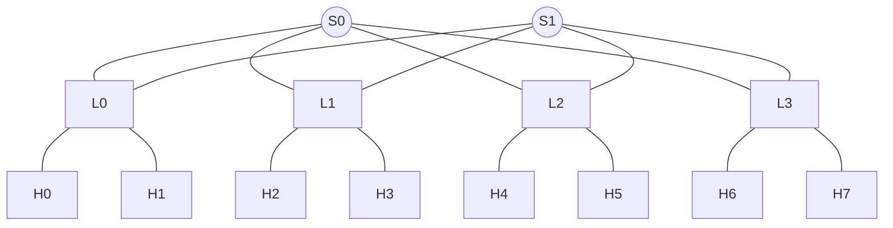

# netsim: an InfiniBand-style network simulator with a verification suite

A discrete-event simulator of a lossless, credit-based network fabric (leaf-spine / 2-level fat-tree),
built in Python together with an automated verification suite: hand-written scenario tests,
physical-bound oracles and 100+ randomized, reproducible scenarios checked against invariants.


## What it models



- **Discrete-event engine**: a priority queue (binary heap) of timestamped events, O(log n) per event.
  Time is an integer number of nanoseconds and ties are broken by insertion order, so every run is
  fully **deterministic**: the same inputs always give the same result, and every failure is reproducible.
- **Links**: serialization delay (`size / bandwidth`) + propagation latency, FIFO queue,
  one packet on the transmitter at a time, several packets in flight on the wire (pipelining).
- **Switches**: store-and-forward, one input buffer per incoming link.
- **Routing (a mini Subnet Manager)**: one BFS per destination computes shortest-path forwarding tables,
  then equal-cost next hops are spread across spines (ECMP-style static load balancing).
- **Credit-based flow control**: a link only transmits when the downstream buffer has a free slot;
  the credit travels back over the cable when the slot is freed. Backpressure, no packet loss.
- **Lossy mode** (Ethernet-like) for comparison: full buffers drop packets.

## How it is verified

| Technique | Examples |
|---|---|
| Exact scenario tests | single packet arrives at 1328 ns; 4-hop path at 4 × 1328 ns |
| Invariants | conservation (`sent == received + dropped`), right destination, buffers never exceed capacity, no packet stuck (no deadlock) |
| Oracle | no packet arrives faster than its physical lower bound (hops × (serialization + propagation)) |
| Randomized scenarios | 50 seeds × lossless/lossy, 300 packets each, random sources, destinations, sizes and start times |
| Determinism | same seed ⇒ identical latencies; different seeds ⇒ different scenarios |
| Mutation checks | deliberately breaking the code (e.g. never returning credits) must make tests fail |

A lesson from building it: a first random workload was too light, the lossy mode never dropped anything
and its conservation test passed without testing anything. The test now also asserts that the scenario
**is** congested (`dropped > 0`).

## Results

All links 100 Gb/s, 1000 ns latency, 4096-byte packets.

**Incast** (7 hosts × 10 packets → one host, buffers of 4 packets)

| Mode | Delivered | Dropped |
|---|---|---|
| Credit-based (lossless) | 70 / 70 | 0 |
| Lossy (Ethernet-like) | 38 / 70 | 32 |

**Buffer sizing**: one credit round trip = 328 (serialization) + 1000 (packet) + 1000 (credit back) = 2328 ns,
so keeping the link busy needs 2328 / 328 ≈ 7.1 → 8 buffer slots (bandwidth-delay product).

| Buffer (packets) | Gap between arrivals |
|---|---|
| 1 | 2328 ns (≈ 14 % of link capacity) |
| 7 | 328 ns with periodic stalls |
| 8 | 328 ns, full rate |

**Randomized scenarios** (50 seeds): 0 drops in lossless mode vs 1024 drops in lossy mode.
The price of losslessness is queuing delay: tail latency grows under congestion instead of packets being lost
(lossy-mode latency only measures the packets that survived).

## Simplifications (on purpose)

Buffers and credits are counted in packets (InfiniBand counts 64-byte blocks); no virtual lanes;
store-and-forward instead of cut-through; static routing (no adaptive routing); no congestion control.

## Run it

```bash
uv sync
uv run pytest -v
```

```
netsim/
  engine.py    discrete-event simulator
  link.py      packets, hosts, links, credits
  network.py   switches, topology, routing
  traffic.py   reproducible random traffic
  metrics.py   latency (avg / p99 / max) and throughput
tests/         scenario, invariant and randomized tests
```